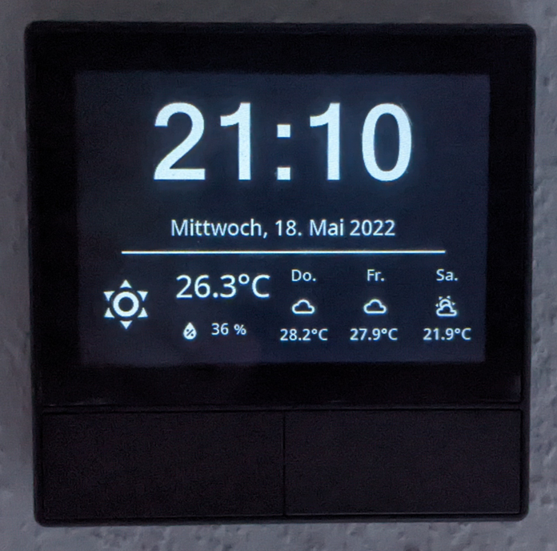
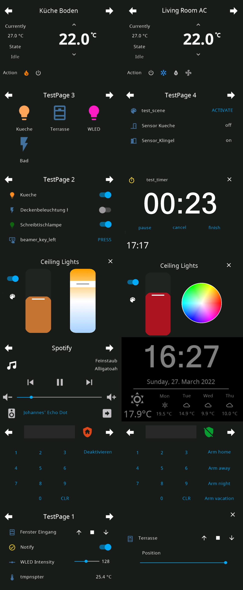
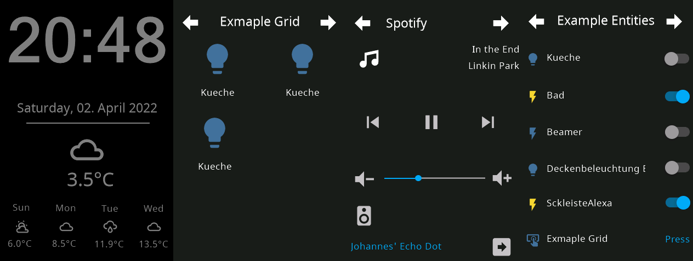

# NSPanel Lovelace UI

If you like this project consider buying me a pizza 🍕 

NsPanel Lovelace UI is a Firmware for the nextion screen inside of NSPanel in the Design of [HomeAssistant](https://www.home-assistant.io/)'s Lovelace UI Design.

**Visit https://docs.nspanel.pky.eu/ for installation instructions and documentation of the configuration.**

Supported Home Automation Systems:

- [Home Assistant](https://docs.nspanel.pky.eu/prepare_nspanel/) - Home Assistant add-on with web editor
- [ioBroker](https://docs.nspanel.pky.eu/prepare_nspanel_ioBroker/) - 3rd-party Typescript Backend maintained by @britzelpuf and @Armilar

NsPanel needs to be flashed with Tasmota (or through a 3rd-party Component with ESPHome)

**EU Model and US Model supported (in portrait and landscape orientation)**

## Features

- Entities Page with support for cover, switch, input_boolean, binary_sensor, sensor, button, number, scenes, script, input_button and light, input_text (read-only), lock, fan, timer and automation
- Grid Page with support for cover, switch, input_boolean, button, scenes, light, lock, timer and automation
- Detail Pages for Lights (Brightness, Temperature and Color of the Light) and Covers (Position)
- Thermostat Page 
- Media Player Card
- Alarm Control Card
- Screensaver Page with Time, Date and Weather Information
- Card with QrCode to display WiFi Information
- Localization possible (currently 38 languages)
- **Everything is dynamically configurable by a yaml config, no need to code or touch Nextion Editor**

It works with [Tasmota](https://tasmota.github.io/docs/) and MQTT. 
The Home Assistant add-on controls the panel and updates its content. Configure it with the web editor or `panels.yaml`; existing AppDaemon configurations can be imported. See the [setup guide](docs/prepare_ha.md) and [migration guide](docs/config-migration-standalone.md).

See the following picture to get an idea of the look of this firmware for NSPanel.

Some (not all) screenshots from the US Portrait Version:

## Home Assistant add-on editor

The Home Assistant add-on includes a web interface for editing panels, cards, entities, and screensavers. Import existing add-on or AppDaemon YAML, review migration warnings, then save and apply. See the [add-on instructions](nspanel-lovelace-ui/DOCS.md).

## Documentation

Visit https://docs.nspanel.pky.eu/ for installation instructions and documentation of the configuration.

## Other Resources

### Alternative Backends for other SmartHome Systems

ioBroker: https://forum.iobroker.net/topic/58170/sonoff-nspanel-mit-lovelace-ui/

IP Symcon: https://community.symcon.de/t/beta-modul-nspanel-lovelace-ui/130109

SmartHomeNG: https://github.com/sisamiwe/shng-nspanel-plugin

OpenHAB: https://github.com/olialb/nspanelMqttBridge

NodeRed: https://github.com/laluz742/node-red-contrib-nspanel-lui

ESPHome without any Backend: https://github.com/olicooper/esphome-nspanel-lovelace-native
