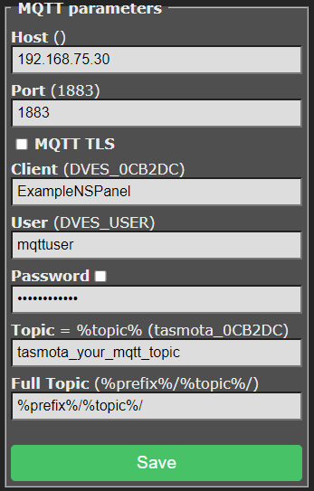

# Connect MQTT and configure a panel

## Configure Tasmota

In Tasmota, open **Configuration → Configure MQTT**. Enter your broker address and credentials, and choose a unique topic such as `nspanel_kitchen`. Keep the default **Full Topic** unless you also adjust both topics in the backend.



## Configure the add-on

Open the add-on's web interface. Select **+** to add a panel, or edit the example panel. Set:

- Receive topic: `tele/nspanel_kitchen/RESULT`
- Send topic: `cmnd/nspanel_kitchen/CustomSend`
- Model: `eu`, `us-p`, or `us-l`, matching your display firmware.
- Locale and time zone for your installation.

Add at least one card and use real Home Assistant entity IDs. The following complete YAML can be pasted into the **YAML editor**:

```yaml
nspanels:
  kitchen:
    panelRecvTopic: tele/nspanel_kitchen/RESULT
    panelSendTopic: cmnd/nspanel_kitchen/CustomSend
    model: eu
    locale: en_US
    timeZone: Europe/Berlin
    timeFormat: "%H:%M"
    dateFormat: full
    screensaver:
      entities:
        - entity: weather.home
    cards:
      - type: cardEntities
        title: Kitchen
        key: home
        entities:
          - entity: light.kitchen
```

Select **Save & apply**, then check the add-on log and panel. Save validates and writes the configuration; it does not confirm that the physical panel is connected.

For multiple panels, add another named mapping under `nspanels`, with different topics. The add-on normally discovers MQTT credentials from Supervisor; external broker settings belong at the top level of `panels.yaml`, as described in the [configuration reference](config-overview.md).

For compatible ESPHome installations, see [connection modes](connection-modes.md). For missing content, use the [troubleshooting guide](troubleshooting.md).
